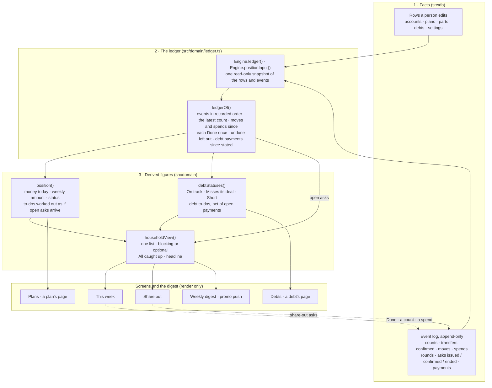

# How a figure gets from what you typed to the screen

Every money figure on every screen is worked out again, from stored facts, each time a
page is drawn. Nothing you see is a number someone saved. After any change, every
screen is refreshed (`afterWrite()` in `src/server/actions.ts`), so no page can show a
figure from before it.

This page maps the layers as they are today. It also names the places that still bend
the rule, so a figure that looks wrong can be traced.

## The three layers

1. **Facts.** What a person typed or confirmed: an account, a part and its due date, a
   count of what an account holds, "Done" on a to-do, a spend, a debt's stated balance.
   Counts, confirmations, moves, spends and payments are events, never edited (migration
   `0001` enforces that). Plans, parts and debts are rows that are edited, with an event
   beside most edits.
2. **The ledger.** The engine reads the rows and events in one read-only snapshot and
   hands the events to `ledgerOf`, which answers every question of order and of what
   counts, once: the last count, then every move and spend recorded after it; every
   confirmed transfer, at the amount said; each "Done" counted once, the first; spends
   taken back left out; a spend in the account it came out of; a debt payment against
   the balance only when recorded after that balance was stated. Account money, the
   rounds, the instructions, debt balances and both histories all read this one answer.
3. **Derived figures.** Pure functions, with no database and today passed in. An ask
   still open is money on its way (D56): it changes no balance and no status, and every
   to-do is worked out as if it arrives. `householdView()` puts the position's to-dos,
   the debts' and the open asks in one list, and says whether the household is caught
   up.
   `position()` is the only place a weekly amount, a status, a one-time move or a to-do
   is worked out. `debtStatuses()` does the same for debts. A screen only formats what
   these return.

## When does a figure change?

On the next page drawn after a fact changes. Nothing waits for a job, and no number is
"refreshed" separately.

| You do | Fact recorded | What re-derives |
| --- | --- | --- |
| Mark "Set the transfer to $Y" done | `set_weekly_transfer` issued and confirmed together | the run-forward, from the transfer after the day it is marked done; the status; the to-dos |
| Mark a one-time move or a move between accounts done | the move (both sides together, for a move between) | money today, until the next count |
| Record what an account holds | `balance_confirmed` | money today starts from the count; earlier moves and spends are inside it |
| Record a spend, finish a round, save back up, undo | `spend_recorded` · `round_finished` · `round_saved_back_up` · `event_undone` | money today, the round open now, the weekly amount |
| Add or edit a plan or a part | rows, plus a `line_item_*` event | the requirements, so the weekly amount and every to-do |
| Change the transfer day or the rounding step | a setting | every weekly figure |
| Run a share-out | asks issued (`cover`, `share_out`, `debt_payment`, `left_over`) | every to-do, worked out as if the open asks arrive; whether caught up |
| Mark an open ask "Not doing this" | `instruction_ended` | whatever the ask was lowering asks again |
| Pay a debt, or state its balance | `payment_confirmed` · `debt_balance_updated` | the likely balance, the status, the debt to-dos |

The "change the weekly transfer" to-do is never issued by an action. It appears whenever
the smallest level transfer that works differs from the one confirmed at the bank, and it
goes away when it no longer does, whatever changed the figures (`accountPosition` in
`src/domain/position.ts`).

## Where the layers still bend

Found in the audit of 2026-10-31. The ledger (Phase 2), the household view (Phase 3,
D56) and the event beside every money write (Phase 4) have since closed the ones about
reading the same facts two ways, the stored asks beside the derived to-dos, most figures
screens worked out themselves, and rows changed with nothing in the log. Each item
left is a place where a figure depends on more than the three layers above, so it is
worth knowing when a number looks odd.

**One snapshot per read, not per page.**
- Each engine read is consistent within itself, but a screen makes several (the position,
  the open asks, the debt statuses). A write landing between two of them can show one
  figure from before it and one from after, until the next page drawn.

**Rows kept beside their events.**
- A part's stored due date is its oldest open round (D53 (9)), moved on by `settleRounds`,
  and a debt's balance goes to zero when a payment clears it (`settleDebtIfCleared`).
  Both are stored rather than derived, but since Phase 4 each move is recorded as an
  event in the same transaction (`line_item_changed` with `reason: 'rounds'`;
  `debt_balance_updated` with `cleared_by_payment`), so the log alone explains the row.

**Old spends read through today's rows.**
- A spend recorded before spends carried their account (before the ledger) is put in
  the account its part is in now. Spends recorded since keep their own account.

**A figure shaped on a screen.**
- A plan's page heads its card "Total cost of this plan" (every live part at full price)
  while its bar and the plans list use the total still needed this time round.

## How it stays this way

- `src/__tests__/layers.test.ts` fails if a screen, a component or the digest imports a
  calculation behind a money figure, and if an engine method writes an account, a plan,
  a part or a debt without recording an event (`recordEvent`) as it does.
- Settings append (migration 0027): a change is a new row, never an edit, and the latest
  written is the setting.

## Still to do

- One snapshot per page, by reading the household view once.
