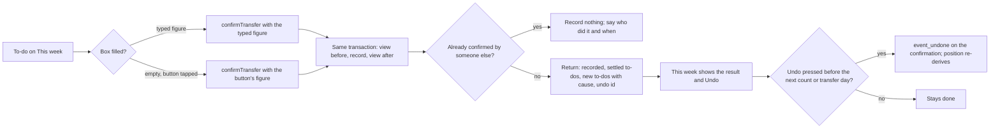

# The weekly to-do loop, and the three other fixes from the evaluation that need the system to change

## System overview

**What this covers.** The service behind This week: two spouses get a list of money to-dos, make the changes at Capital One 360, and tell Ballast what they did. Ballast never moves money. A to-do is done only when a person says so. This blueprint redesigns that loop so that saying "done" is honest, visible to both spouses, and reversible. It also covers three smaller fixes where the screen is wrong because of how the data reaches it:

- Share out shows a computer-style date.
- Best times to go ranks windows without saying what it ranked on.
- Settings has seven separate saves.

**Who it serves.** Two adults sharing one household's savings, usually on a phone, often at different times. One makes the transfers in the Capital One app; either may open Ballast later and needs to know what has already been done.

**How it fits.** Every figure comes from the one position (`src/domain/position.ts`), read through `Engine.position()`. The to-do list is derived by `householdView` (`src/domain/household-view.ts`), never stored. Everything that happens is an append-only event in Postgres. The fixes below keep all four of the project's rules: math in `src/domain`, facts stored and derivations computed, one write path through the engine, one position.

**Out of scope here.** The evaluation's other findings change only what a screen shows, with no change to how data flows:
- This week explaining each figure twice
- the copy fixes
- placeholder figures
- chart label sizes
- zero cents on lead figures
- the focus ring
- splitting Trips into a browsing page and a "Trip settings" page

That splitting is a routing change. Its one data need is named under Process architecture.

## Service blueprint

The diagram is in [blueprint-ballast-improvements.html](blueprint-ballast-improvements.html). It shows the loop as it should work. Below, each stage says who acts, what Ballast does behind the screen, and what holds it up.

| Stage | Frontstage: the spouse doing transfers | Frontstage: the other spouse | Backstage: Ballast | Support |
| --- | --- | --- | --- | --- |
| 1. The week starts | Gets the digest on the transfer day, or opens This week | Same | `buildWeeklyDigestIfDue` runs on the household's transfer day; `householdView` derives the to-dos from the position | n8n delivers the digest; the scheduler; Postgres |
| 2. Read a to-do | Reads "set the recurring transfer into Annual Expenses to $420.00" | Reads the same list | Nothing is issued ahead: the to-do exists only while the position says it is needed | `position()` |
| 3. Act at the bank | Opens Capital One 360 and changes the transfer | Not involved | **Line of interaction with a party Ballast cannot see.** Ballast has no bank access, so it knows only what a person tells it | Capital One 360 (external) |
| 4. Say it is done | Types the figure the bank now shows, or taps "Done: it's $420.00" | — | `confirmTransfer` records the instruction and its confirmation in one transaction. In the same transaction it derives the to-dos before and after, and returns the difference | `recordEvent`; the append-only trigger (migration 0001) |
| 5. See what changed | Sees "Recorded: Annual Expenses moves $420.00 a week · Undo", what it settled, and any new to-do it caused, with the reason | Sees it under "Done lately" with who did it and when | "Done lately" is read from the event log (confirmations in the last 7 days, with the actor); nothing new is stored | `ledgerOf` |
| 6. Take it back if wrong | Taps Undo | May Undo too (see Open questions) | Records `event_undone` on the confirmation; the ledger leaves it out; the position re-derives | `ledgerOf`'s undone set, extended to confirmations |
| 7. All caught up | Sees "All caught up" | Sees the same | `householdView.caughtUp` | — |

**Where it hurts today:**

- **The confirmation box is pre-filled.** Stage 4 can be done without stage 3. → *Confirmed without acting at the bank*
- **Done gives no feedback.** The card simply vanishes. → *A new to-do appears with no reason*
- **There is no Undo for a confirmed transfer.** → *Wrong card confirmed*
- **The other spouse never learns who did what.** → *Both spouses act on the same to-do*

## Ecosystem & dependencies

**Actors**

- *The spouse doing transfers.* Acts at the bank and in Ballast, usually on a phone, often between other things.
- *The other spouse.* Reads Ballast at another time. Can change shared accounts. An `individual` account is written only by its owner (`canWriteAccount` in `src/domain/types.ts`).
- *Capital One 360.* Where money actually moves. Ballast cannot see it.
- *Ballast's engine.* The only writer (`src/server/engine.ts`), bound to one household.
- *n8n.* Delivers the digest. Ballast computes it; n8n only sends it.

**What depends on what**

- **To-dos ← position ← ledger ← events.** Every to-do is a function of the event log at one moment. That is why "what changed" can be derived and never needs storing.
- **Status ← confirmed transfer.** An account is judged on the transfer confirmed at the bank, never on an ask still open (CLAUDE.md, D35). So a confirmation that is not true makes a Short account read On track. This is the most expensive dependency in the loop.
- **Share out's reasons ← `debtStatusLine`.** `shortfallReasons` flattens the sentence parts into one string (`src/domain/shortfall.ts:67`). That drops the date marker that turns "2027-04-30" into "in 5 months". It also writes its own sentence with a raw date (`:82`).
- **Best times to go ← `scoresOf`.** It returns a rank but not which of quiet, cheap and school days had any data behind it.

**Who owns what.** One household, two people, one codebase. There are no team handoffs. The handoff that matters is between the two spouses, across time. Today nothing carries "I already did this" from one to the other except the to-do disappearing.

**Risk areas**

- The confirmation is a single point of truth with no check against the bank. Undo and an honest box are the only safeguards.
- An undo that reaches back past a count would rewrite money a person has already checked.

## Process architecture

**Confirming a to-do (target flow)**

**Decision points**

- *What figure is recorded.* A typed figure wins. An empty box records the figure the button shows, never the asked figure silently. One function decides this, beside `countsFromForm` in `src/domain/check-in.ts`.
- *Already done.* If the instruction already has a confirmation, the first one counts (the existing ledger rule). The second press records nothing and says who did it and when. → *Both spouses act on the same to-do*
- *The cause of a new to-do.* A to-do in the after view and not in the before view is new. Its cause is the confirmation just made, and its sentence already gives the reason ("Annual Expenses has it to spare, and Car & Home needs it"). → *A new to-do appears with no reason*
- *Whether Undo is offered.* Only until the next count of that account or the household's next transfer day, whichever comes first. → *Undo after a count*

**Timing.** All of it is one request. The before and after views are read inside the confirming transaction, so nothing another person does can land between them.

**Feasibility.** No new tables, no new stored figures. The work is:
- one engine return shape
- `ledgerOf` honouring `event_undone` on instruction confirmations
- one form function
- a "Done lately" reader over existing events
- a new invariant in `position.test.ts`: undoing a confirmation gives exactly the position from before it.

**The other three fixes**

- *Share out's dates.* `ShortfallReason.reason` becomes `SentencePart[]`, built by `debtStatusLine` and by a sentence function for the one-time move. Share out renders it through the same component as This week. → *Computer-style date on Share out*
- *Best times to go.* `explore` returns `basis`: which of busyness, price and school had data for any candidate. Each window also says which facts it lacks (`missing: 'crowd' | 'lodging' | 'drive'`), so "no price yet" can link to where prices are added. The Trips split uses the same field to link each gap to its form on the new settings page. → *Ranking with no data behind it*
- *Settings.* Each section stays its own form and its own appended setting row. The page warns before leaving, or before submitting one section, while another section has unsaved edits. → *One section's save drops another's edits*

## State & failure analysis

**States of one to-do:** derived (the position needs it) → confirmed (a person said it is done) → undone (taken back; it is derived again if still needed) → closed (Undo is no longer offered, after the next count or transfer day). Nothing about a to-do is stored but the confirmation and its undo.

| Failure | What the person experiences | Blast radius | Recovery |
| --- | --- | --- | --- |
| **Confirmed without acting at the bank** | Today the pre-filled box makes this one tap. The account reads On track while the bank still moves the old amount. | Every figure for that account, every week, until the next count shows less money than expected | Prevented: the box starts empty and the button names the figure. Caught: Undo, and the next count corrects the money today. Cost if missed: the account runs short on the date it was going to. |
| **Wrong card confirmed** | Today there is no Undo. Fixing it means confirming the old amount again, which reads in the history as a second bank change. | That account's figures | Undo records `event_undone` on the confirmation. The position re-derives and the to-do returns. |
| **A new to-do appears with no reason** | Today a different to-do appears at the top and the person does not know why. | Trust in the list | The confirmation's result lists the new to-do as new, with its own sentence's reason. |
| **Both spouses act on the same to-do** | Today the second person, on a page opened earlier, presses Done. Ballast keeps the first confirmation and drops the second silently, but the bank may have been changed twice. | A transfer set twice, or a move made twice at the bank | Done lately shows who confirmed what and when. A second press says "Already done by Alex at 9:14" and records nothing. |
| **Undo after a count** | A person undoes a transfer after someone has counted the account. The count already saw the real money, so the undo would move a checked figure. | Money today for that account | Undo is not offered after a count of that account or after the next transfer day. Past that point, the fix is a new confirmation of the right amount. |
| **Computer-style date on Share out** | "The 0% ends 2027-04-30" | Share out only | Reasons carry sentence parts and render like everywhere else. |
| **Ranking with no data behind it** | A numbered list that reads like a recommendation, built only on school days | Trip choice | `basis` lets the screen say what the ranking rests on, and each gap links to where it is filled. |
| **One section's save drops another's edits** | Likely: edits in a second section vanish after saving the first. | One setting | Unsaved-edit warning before submitting or leaving. |
| **How the loop ends each week** | Every to-do is confirmed or no longer needed, and This week says All caught up. Undo windows close at the next count or transfer day. Done lately drops entries after 7 days; the events stay in the log forever, as for every fact. | — | — |

## Open questions

- When one spouse marks a transfer done, should the other hear about it, or is seeing it under Done lately enough?
- Can either spouse undo the other's confirmation on a shared account, or only the person who made it?
- Should Done lately cover the last 7 days, or only since the last transfer day?

## Decision log

| Decision | Chosen | Chosen against | Why |
| --- | --- | --- | --- |
| Where "it was recorded" lives | **Done lately**, derived from the event log | A one-time flash message after the action | It survives a reload, and the other spouse sees it. It needs no new storage, so facts stay stored and derivations computed. A flash message is lost on reload and never reaches the other person. |
| How a confirmation is taken back | **`event_undone`** on the confirmation, honoured by `ledgerOf` | Recording a second confirmation of the old amount | It is one undo mechanism, the one spends, finishes and save-backs already use (`src/domain/ledger.ts:22`). A second confirmation would read in the history as another bank change. Assumption: honouring the undo in `ledgerOf` touches the transfer-in-force rule. Before it ships it needs the new property invariant and a run of the existing invariants with more seeds. |
| How long Undo is offered | **Until the next count of that account or the next transfer day** | No time limit | A count after the confirmation already measured the real money, and undoing behind it would move a figure a person checked. The transfer day is when the bank acts on the change. |
| How "what changed" is known | **Before and after views derived in the confirming transaction** and returned | Storing a cause on each to-do | To-dos are derived. Storing a cause would be a stored derivation, the source of sync glue the project rules forbid. |
| The confirmation box | **Empty, with the asked figure as a hint and on the button** | Keep it pre-filled | It matches Check in (PRD D57), and it makes the honest path and the quick path the same tap without making "I did it" the default. |
| A second confirmation of the same to-do | **Record nothing and say who did it** | Record it, as today, where only the first counts | Today the second is kept and ignored, which tells the second person nothing. Saying who did it is what stops a second change at the bank. |
| Share out's reasons | **Sentence parts from the one builder** | Format the date on the Share out screen | The project rule is one definition per figure and sentence. Formatting on the screen would leave two sentence builders. |
| Best times to go with missing data | **`explore` returns its basis and each window's gaps** | Let the screen guess from "no price yet" text | The domain knows what was missing. The screen must not work it out. |
| Settings saves | **Warn about unsaved edits in another section** | Save each field as it changes | Share-out percentages must add to 100, so a half-edited set is invalid. A row and an event on every change of focus would clutter the history. |
